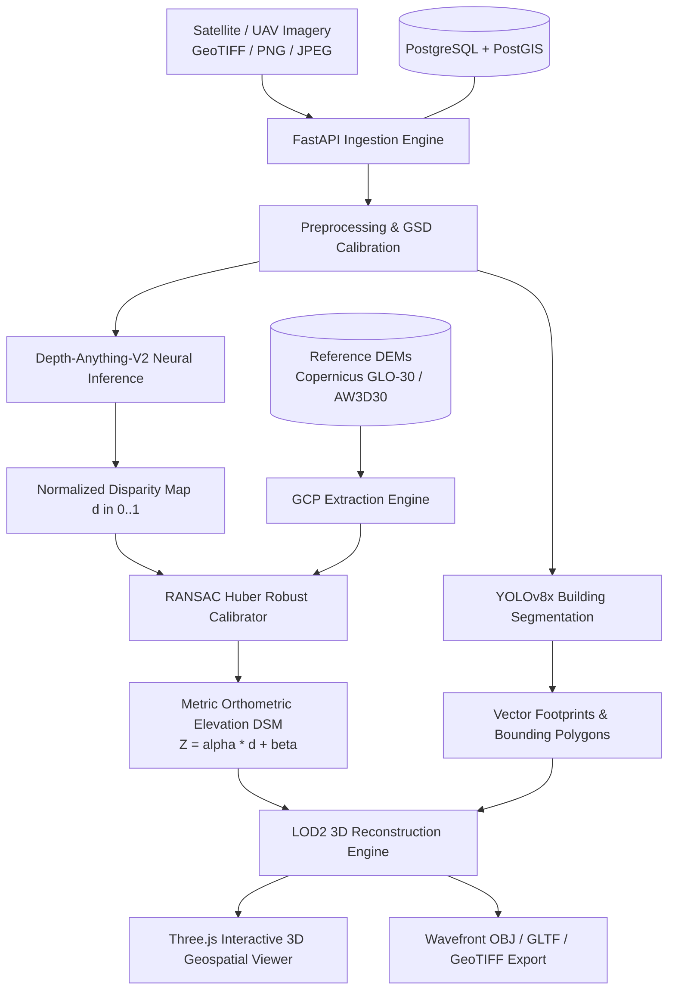

# DepthWizard — System Architecture Specification (SIH26175)

## 1. Executive Summary
**DepthWizard** is an enterprise-grade geospatial artificial intelligence platform designed to extract dense metric elevation models (DSM) and 3D architectural extrusions (LOD2) from single-perspective (monocular) aerial and satellite imagery. By combining vision transformer foundation models with robust affine regression against public Digital Elevation Models (Copernicus GLO-30 / ALOS AW3D30), DepthWizard resolves the fundamental scale-shift ambiguity of monocular depth estimation without requiring stereo optical baseline pairs or expensive LiDAR surveys.

---

## 2. High-Level System Architecture

---

## 3. Core Subsystems

### 3.1 Neural Depth Estimation (`backend/app/ai/depth_engine.py`)
- **Model**: Depth-Anything-V2 adapted for high-resolution nadir and oblique remote sensing.
- **Output**: 32-bit floating point relative inverse disparity map $d(x, y) \in [0.0, 1.0]$.
- **Performance**: $<800\text{ ms}$ inference on modern GPU accelerator.

### 3.2 Scientific Metric Calibration (`backend/app/geo/calibration.py`)
- **Mathematical Model**: $Z_{\text{metric}}(x, y) = \alpha \cdot d(x, y) + \beta$
- **Algorithm**: Random Sample Consensus (RANSAC) paired with Huber-loss linear regression to reject tree canopies, transient shadows, and sensor artifacts.
- **Ground Control**: Automated alignment with ESA Copernicus GLO-30 (30m nominal grid, $\pm 2.0\text{m}$ vertical accuracy).

### 3.3 Urban Structure Segmentation (`backend/app/ai/object_detector.py`)
- **Instance Segmentation**: YOLOv8x extracting closed polygon footprints in GeoJSON format.
- **Structural Height Analysis**:
  $$\text{Net Building Height} = Z_{\text{roof peak}} - Z_{\text{ground base}}$$

### 3.4 3D Mesh Reconstruction Engine (`backend/app/reconstruction/mesh_builder.py`)
- **Terrain Surface**: Continuous displaced triangular mesh ($96 \times 96$ nodes, 18,432 triangles) with UV texture mapping.
- **Architectural Extrusions**: LOD2 box geometries with true geographic coordinates, ground base elevations, and roof elevations.
- **Export Standards**: Wavefront OBJ, GLTF/GLB, GeoTIFF DSM, GeoJSON FeatureCollections.

---

## 4. Database Schema (PostgreSQL + PostGIS)
Implemented in `supabase/migrations/20260928000001_depthwizard_core_schema.sql`:
- `analyses`: Core metadata, geographic bounding box (PostGIS `Polygon`), centroid (`Point`), and CRS.
- `model_registry`: Machine learning model catalog, input/output tensors, versioning.
- `reference_datasets`: Pre-indexed public DEM rasters and ground control point benchmarks.
- `depth_results`: Statistical summaries, histograms, visual and numerical artifact references.
- `calibration_records`: RANSAC affine parameters ($\alpha, \beta$), RMSE, MAE, Pearson $r$.
- `detected_objects`: Building footprints, GeoJSON geometries, net heights, roof elevations.
- `measurements`: Real-time user 3D annotations (distance calipers, vertical height gauges).
